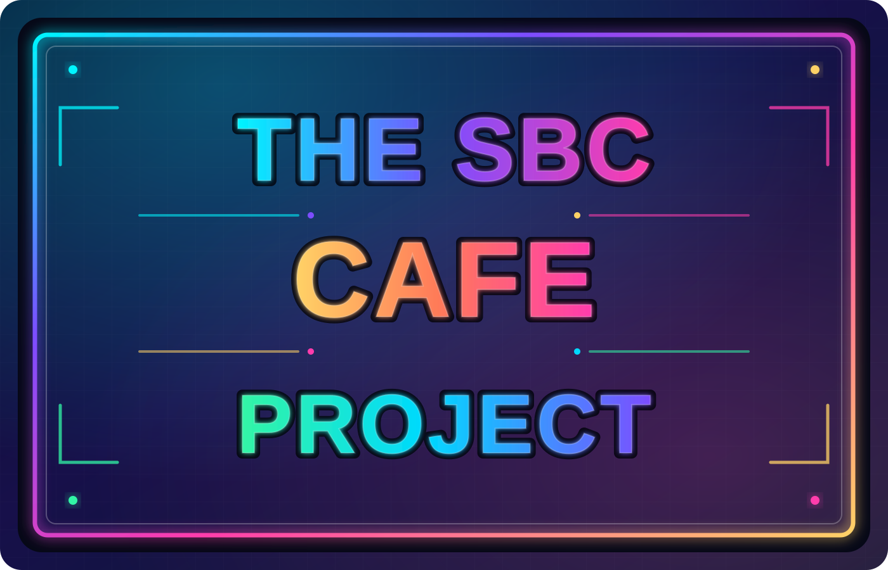

<div align="center">

# SBC Cafe Mobile Order Project

<a href="https://nodejs.org"></a> <a href="https://angular.dev/events/v22"></a>

<br />
<br />
</div>

South Bay Church - Web app for mobile ordering from the cafe



## Project

https://github.com/users/mgraphic/projects/2

---

## Repository

https://github.com/mgraphic/SBC-Cafe-Mobile-Order

---

## Demo

To run the demo directly from your computer, you will need Docker Desktop installed. This is a free software available to download at [Docker Desktop](https://www.docker.com/products/docker-desktop/)

Once you downloaded this code base or cloned it directly from [Git](https://git-scm.com/downloads) you can run the commands below from a terminal or command console to create the demo platform. Be sure that Docker Desktop is open and running.

Run this command to build and run the demo:

```sh
docker compose -f docker-compose.local.yml up --build -d
```

Open the browser to view both the [store](http://localhost:80) and [admin](http://localhost:81) sites:

```sh
open http://localhost:80
open http://localhost:81
open http://localhost:8025
```

### Access the demo from the local network

The optional LAN overlay serves the store and admin over HTTPS, which is
required for browser APIs such as `crypto.randomUUID()` on a LAN IP address.

Use the following to set the IP address of the network dynamically or manually.

_Mac (bash/zsh):_

```bash
export CAFE_LAN_IP=$(ipconfig getifaddr en0)  # macOS (en0 is typical WiFi)
```

_Windows (powershell):_

```powershell
$CAFE_LAN_IP = (Get-NetIPAddress -AddressFamily IPv4 | Where-Object {$_.InterfaceAlias -like "*Wireless*" -or $_.InterfaceAlias -like "*Wi-Fi*"} | Select-Object -First 1).IPAddress
```

_Verify It:_

```bash
echo $CAFE_LAN_IP  # it should read something like 192.168.X.X

# You can set it manually too:
# export CAFE_LAN_IP=192.168.X.X  # Replace with a real network IP address
```

On the Docker host, install [mkcert](https://github.com/FiloSottile/mkcert),

```sh
brew install mkcert
```

then create a locally trusted certificate outside the repository:

```sh
mkcert -install
mkdir -p "$HOME/cafe-local-tls"
mkcert -cert-file "$HOME/cafe-local-tls/cert.pem" \
  -key-file "$HOME/cafe-local-tls/key.pem" \
  "${CAFE_LAN_IP}"
```

Docker command to build and run the demo:

```sh
docker compose -f docker-compose.local.yml -f docker-compose.lan.yml up --build -d
```

On each client computer, trust the host's mkcert root CA certificate
(`rootCA.pem` in the directory printed by `mkcert -CAROOT`) using that
computer's trust store. Transfer only `rootCA.pem`, **never** `rootCA-key.pem`
or the server's `key.pem`. Use the same IP in the URL and the certificate:

- Store: `https://192.168.X.X`
- Admin: `https://192.168.X.X:8443`

Mock checkout is served through the store's HTTPS address, so customers on the
LAN can open the payment page and return to the store. The backend still uses
the Docker-internal Stripe mock API. Restarting the mock container clears its
in-memory checkout sessions; finish any active demo checkouts first.

If needed, allow inbound TCP ports 443 and 8443 through the host firewall.
Verify `window.isSecureContext` is `true` in the browser console. This is a
local demo with mock services and demo credentials, not a production deployment;
use it only on a trusted network. The original HTTP ports and other demo service
ports remain published. When using the overlay, the built frontend and backend
links point to the LAN HTTPS URLs, even when the app is opened over HTTP.

### Demo Login Credentials

| Role           | User Name      | Username/Email     | Password    |
| -------------- | -------------- | ------------------ | ----------- |
| Demo Admin     | Admin User     | admin@example.com  | demo        |
| Barista User A | Monica Barista | monica@example.com | baristademo |
| Barista User B | Carlos Barista | carlos@example.com | baristademo |

When you want to shut everything down, use the following command to stop and remove all the demo containers and images:

```sh
docker stop $(docker ps -a -q) && docker rm $(docker ps -a -q) && docker rmi -f $(docker images -aq)
```

---

## Dev

To build and package the shared module:

_./Apps/shared_

```sh
npm run build
```

To automatically distribute and install the build file to the apps run the following command:

```sh
node ./distribute.js
```

Copy the artifact from the `output` dir to the `Apps/*-service/custom_modules/`

Run this command to build and run the db and mock servers _(Stripe and Brevo along with mail viewer)_:

```sh
docker compose -f docker-compose.dev.yml up --build -d
```

### DB Viewer

Open [DynamoDB Viewer](http://localhost:8011) to see tables and data.

### Splunk

Open [Splunk Web](http://localhost:8001) and sign in with the following local credentials:

| Username | Password     |
| -------- | ------------ |
| admin    | ChangeMe123! |

The HTTP Event Collector is available at `http://localhost:8088` with token `local-splunk-hec-token`.

For a general search, type `index=main` in the Splunk search bar.

When you want to shut everything down, use the following command to stop and remove all the demo containers:

```sh
docker stop $(docker ps -a -q) && docker rm $(docker ps -a -q) && docker rmi -f $(docker images -aq)
```

---

## Stripe Sandbox

To work with payments, you will need to create a free sandbox account with [Stripe](https://dashboard.stripe.com/register).

Once you have created an account and logged in, you will be in **Test mode**.

You will need to add products to your Stripe account. For each product, you must add a `slug` in the metadata.

1.  From the Stripe dashboard, go to the "Products" page.
2.  Click "Add product".
3.  Fill out the product details (Name, Description, Image, Price).
4.  In the "Metadata" section, add a key called `slug` and give it a value. The slug should be a URL-friendly version of the product name (e.g., `iced-coffee`).
5.  Click "Save product".

Repeat for all the products you want to have in the cafe store.

You will also need to add your Stripe API keys to the project.

1.  From the Stripe dashboard, go to the "Developers" page and then the "API keys" page.
2.  You will find your **Publishable key** and **Secret key**.
3.  Create a new file named `.env` in the root project directory.
4.  Add the following lines to the `.env` file, replacing the placeholder values with your actual keys:

```
STRIPE_PUBLISH_KEY=pk_test_...
STRIPE_SECRET_KEY=sk_test_...
```

Run this command in order to run the Stripe Mock API:

```sh
docker compose -f docker-compose.local.yml up --build stripe-mock-api -d
```

---

## Docker

To build and/or run a specific container, refer to the container service name...

```sh
# Build and run the cafe store container
docker compose up --build cafe-store -d

# Only build the cafe store container
docker compose build cafe-store

# Only run the cafe store container
docker compose up cafe-store -d
```

To build and/or run ALL containers, use the following command...

```sh
# Build and run all containers
docker compose up --build -d

# Only build all containers
docker compose build

# Only run all containers
docker compose up -d
```

Other docker commands...

```sh
# List containers
docker ps

# Stop and remove containers
docker compose down

# Remove all images
docker rmi -f $(docker images -aq)

# Stop all the containers
docker stop $(docker ps -a -q)

# Remove all the containers
docker rm $(docker ps -a -q)
```

To build and run local DB container, use the following command...

```sh
# To build and run local DB and iniitialize the schema and data for the first time
docker compose -f docker-compose.local.yml up db-init -d

# Run the local DB without initializing the data
docker compose -f docker-compose.local.yml up dynamodb-local -d

# List defined tables (requires AWS-CLI installation)
AWS_ACCESS_KEY_ID=dummyaccesskey AWS_SECRET_ACCESS_KEY=dummysecretkey aws dynamodb list-tables --endpoint-url http://localhost:8000 --region dummy-region
```

---

## References

- [AWS-CLI](https://docs.aws.amazon.com/cli/latest/userguide/getting-started-install.html) Installation
- [Docker Desktop](https://www.docker.com/products/docker-desktop/) Installation
- [Git](https://git-scm.com/downloads) Installation
